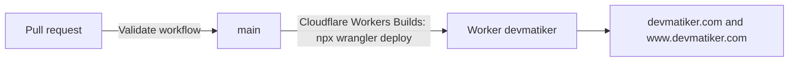

# devmatiker.com

The website of devmatiker, Team 2 of the Computer Science AP degree (datamatiker) at UCL University College in Odense. It presents the team and its project, [NF Hotel](https://github.com/NF-Hotel/NFHotel).

It is one static page: semantic HTML5 and CSS, no JavaScript, no cookies, no tracking, and nothing loaded from another origin.

## How it is published



1. A change goes in as a pull request. The **Validate** workflow checks the HTML and CSS with the W3C Nu validator (a warning fails too), that the security headers are in place, and that no page loads anything from another origin.
2. When it is merged to `main`, Cloudflare Workers Builds runs `npx wrangler deploy`, which publishes `public/` as the static assets of the Worker `devmatiker` (`wrangler.jsonc`). There is no build step and no token in this repository.

## Layout

| Path | What it is |
| --- | --- |
| `public/index.html`, `public/404.html` | The pages |
| `public/styles.css` | The only stylesheet; system fonts, light and dark themes |
| `public/_headers` | Security headers for every response: a strict content security policy, HSTS, no framing, no sniffing, a tight permissions policy |
| `public/.well-known/security.txt` | Where to report a security problem (RFC 9116) |
| `wrangler.jsonc` | What Cloudflare publishes, the 404 handling and the custom domains |
| `.github/workflows/validate.yml` | The checks of every pull request |

## Change the page

Edit the files in `public/`, check them locally with the validator, and open a pull request:

```bash
docker run --rm -v "$PWD/public:/site:ro" ghcr.io/validator/validator:latest vnu --Werror --also-check-css /site/index.html /site/404.html /site/styles.css
```

Keep the page free of scripts and of files from other origins: the content security policy in `_headers` blocks them, and the workflow refuses them.

## Report a security problem

Use [a private security advisory](https://github.com/NF-Hotel/devmatiker-site/security/advisories/new), not a public issue.
